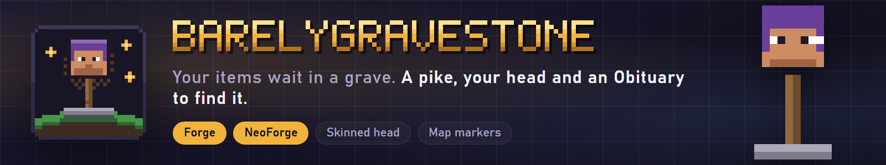

# Barely Gravestone



**Graves for Forge and NeoForge.** When you die, everything you carry waits in a gravestone: a thin pike with your own skinned head on top. An Obituary tells you how, when and where you died and what is still in the grave, and particles lead you back to it.

- **Grave on death:** main inventory, armor, off-hand and Curios slots go into a gravestone at the place you died (or the nearest valid spot). A death in water or lava puts a cobblestone block at the surface with the grave on top; with no ground at all a cobblestone goes under the grave. If nothing fits, the items drop as usual. Every death makes its own grave, and graves never expire unless you set a timer.
- **The pike:** a block entity renderer draws the dead player's real skin on the head (offline names get the default skin).
- **Obituary:** given to you when you respawn (kept for you if your inventory is full). Right-click it for a book with the death message, the real date and time plus the in-game day, the dimension and coordinates, the XP price and the stacks still in the grave. The list updates as items are taken.
- **Follow the particles:** while you hold the Obituary, dim particles drift from you toward the grave (same dimension only).
- **Collect:** right-click the grave with an empty hand. `collectBy` is `OWNER_ONLY` (default) or `ANYONE`; `teamMembersCanOpen` adds scoreboard teams (and FTB Teams or Open Parties and Claims where they exist). A player who may not collect gets a chat message. Operators and creative players can always collect. Survival players cannot break a grave; collecting removes it when it is empty.
- **XP price:** `xpCostPercent` takes that share of your XP levels when the grave is made; with `keepLostXp` the XP is stored in the grave and handed to the collector.
- **Death marker:** on map mods (see the wiki for the list per version) a marker shows at the grave while you carry the Obituary, and goes away when the grave is emptied.
- **Operators:** `/gravestone list [player]`, `tp <id>`, `remove <id>`, `restore <id> [player]` and `obituary <id> [player]`.

Server side authoritative; works on dedicated servers and in single player. The grave data lives in the block entity, so it survives restarts.

## Versions

One jar per loader and Minecraft version: Forge and NeoForge for 26.3, 26.2, 26.1.2, 1.21.1 and 1.20.1. See `PROJECT_STATUS.md` for what is built and verified.

## Configuration

`barelygravestone-common.toml` in the config folder (every option has a comment): `collectBy`, `teamMembersCanOpen`, `xpCostPercent`, `keepLostXp`, `graveExpiryMinutes` (0 = never), `showCoordinates`, `deathMarker`, `obituaryParticles`.

## Building

Each module is its own Gradle build (`forge-<mc>/`, `neoforge-<mc>/`) with its own wrapper. Shared Minecraft-free code is in `common/`, loader-neutral game code per Minecraft version in `version-<mc>/`.

```
cd forge-26.3
./gradlew build
```

Development tools (a headless self test and a screenshot tour) only build with `-PdevTools`; release jars never contain them. The headless self test runs with `BARELYGRAVESTONE_SELFTEST=1 ./gradlew runServer -PdevTools`.

## License

MIT, see [LICENSE](LICENSE). Docs: https://itmecasey.com/wiki/barelygravestone/
