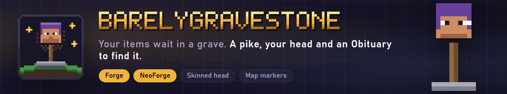

**Graves for Forge and NeoForge: your items wait under a pike with your own skinned head on top, and an Obituary shows the way back.**

When you die, everything you carry (inventory, armor, off-hand and Curios slots) goes into a gravestone where you fell. The grave is a thin pike with your real skin on its head. You get an Obituary: a book that tells you how, when and where you died and lists what is still in the grave. Hold it and dim particles drift toward the grave. Right-click the grave with an empty hand to collect.

Docs and the full config: [itmecasey.com/wiki/barelygravestone](https://itmecasey.com/wiki/barelygravestone/)

- **One grave per death:** graves never expire unless you set a timer (default off).
- **Smart placement:** the nearest valid spot. Die in water or lava and a cobblestone block is set at the surface with the grave on top; with no ground below, a cobblestone goes under the grave. If nothing fits, the items drop as usual.
- **Your head on a pike:** drawn from the stored game profile, so it shows the dead player's actual skin (offline names get the default skin).
- **Obituary:** given on respawn (kept for you when your inventory is full). The page shows the death message, the real date and time with the in-game day, the dimension and coordinates (hideable), the XP price, and the stacks still in the grave, updating as items are taken.
- **Server side:** works on dedicated servers and in single player. Everything is saved in the grave, so it survives restarts.

1. You die. Your items go into a grave; the XP price (if you set one) is taken.
2. You respawn with an Obituary. Hold it: particles lead you to the grave, in the same dimension only.
3. Right-click the Obituary to read it, right-click the grave with an empty hand to collect.
4. Whatever does not fit in your inventory stays in the grave; the grave removes itself when it is empty.

- `collectBy`: `OWNER_ONLY` (default) or `ANYONE`. A player who may not collect gets a chat message and no items.
- `teamMembersCanOpen` (default off): members of the dead player's team can collect too (vanilla scoreboard teams, plus FTB Teams and Open Parties and Claims where they exist).
- Operators and creative players can always collect. Survival players cannot break a grave.
- `xpCostPercent` (0 to 100, default 0): that share of your XP levels is the price of keeping your items. `keepLostXp` (default off) stores that XP in the grave and hands it to whoever collects.
- `graveExpiryMinutes` (default 0, never), `showCoordinates`, `deathMarker`, `obituaryParticles`.
- Operator commands: `/gravestone list [player]`, `tp <id>`, `remove <id>`, `restore <id> [player]`, `obituary <id> [player]`.

- **Curios:** items in Curios slots go into the grave with the rest.
- **Map mods:** a death marker shows at the grave while you carry the Obituary and disappears when the grave is emptied. Which map mods are supported on which version is listed on the wiki.
- **Teams:** FTB Teams and Open Parties and Claims count for `teamMembersCanOpen` where those mods have a build.
- Everything is optional: nothing breaks when these mods are missing.

Install: put the jar for your Minecraft version in `mods` on the server and on every client. Each file is built for one loader and one Minecraft version.

The pictures on this page are illustrations drawn for the listing, not game screenshots.

**Tested:** the shared logic passes its unit tests and a headless server self test of the grave rules (placement in water, rock and void, who may collect, the XP options, expiry, the commands). The Forge 26.3 build was run on a real client with a real death: the pike with the skinned head, the Obituary screen and its live list, the particles and collecting were looked at in screenshots. The other builds are listed on the wiki with what has been checked on each.

**Does it work with keepInventory?** The game rule still wins: with keepInventory on you keep your items and no grave is made.

**What if there is no room for a grave?** The items drop normally.

**Source and issues:** [github.com/ItMeCasey/BarelyGravestone](https://github.com/ItMeCasey/BarelyGravestone)
